# Smart Rental System 🏡✨
### *Next-Generation Intelligent Property Leasing Platform Powered by Flutter, Firebase & Stripe*
### *基于 Flutter、Firebase 与 Stripe 的新一代全闭环智能房屋租赁系统*

<p align="center">
  <a href="#-english-documentation">English Documentation</a> •
  <a href="#-中文文档">中文说明文档</a> •
  <a href="#-application-visual-walkthrough--实机运行预览">Live Screenshots</a>
</p>

<p align="center">
  <a href="https://youtu.be/iYnOc6fSKF4"></a>
  
  
  
  
  
  
  
  
</p>

---

## 🖼️ Application Visual Walkthrough / 实机运行预览

> [!TIP]
> 📺 **Live Video Demonstration**: You can watch the full dual-device interactive demonstration on YouTube: [https://youtu.be/iYnOc6fSKF4](https://youtu.be/iYnOc6fSKF4).  
> All screenshots below are captured directly from real-time simultaneous interaction between **Tenant** (Pixel 8 Pro) and **Landlord** (Pixel 9 Pro).

| 1. Property Upload & Specification / 房源上传 | 2. Bilingual Contract Generation / 双语合同拟定 |
|:---:|:---:|
| 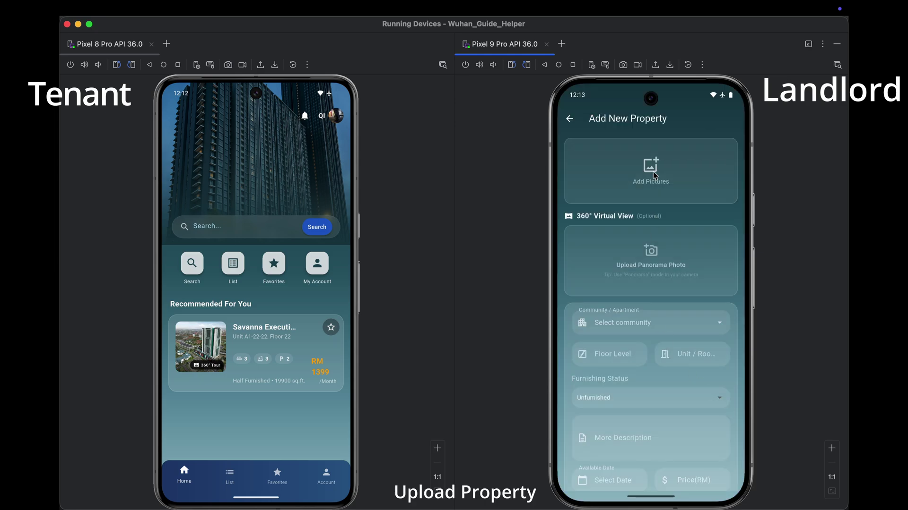 | 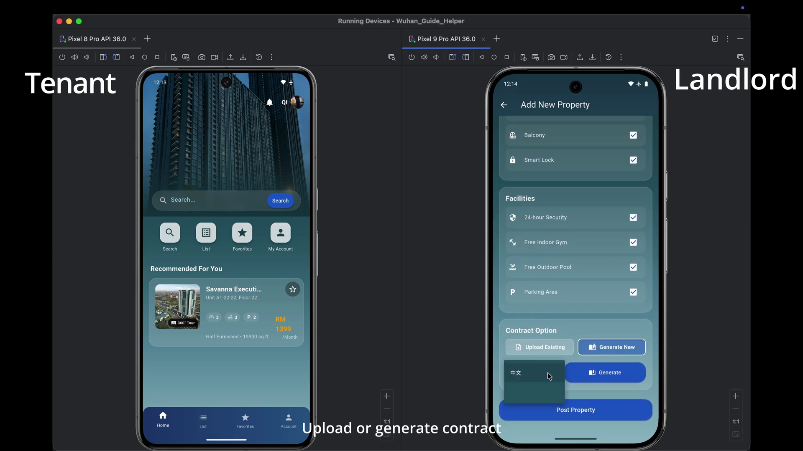 |
| *Landlord uploads photos, 360° VR panorama & price*<br>房东录入房源照片、360° 全景图、配套设施与租金 | *Option to upload custom contract or generate in EN/ZH*<br>支持上传已有合同或在线生成中英文合规租约 |

| 3. Feed Discovery & Watchlist / 房源发现与收藏 | 4. Side-by-Side Comparison Matrix / 横向对比矩阵 |
|:---:|:---:|
| 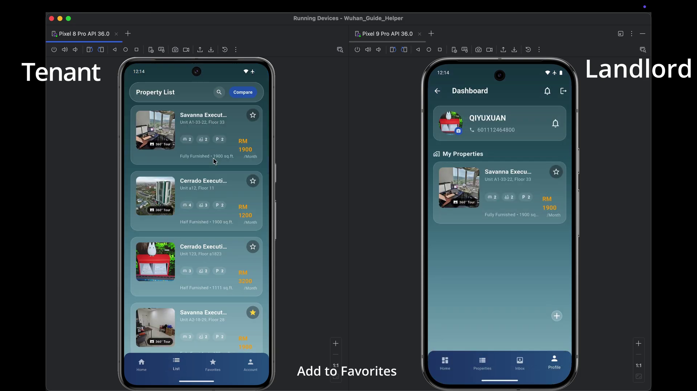 | 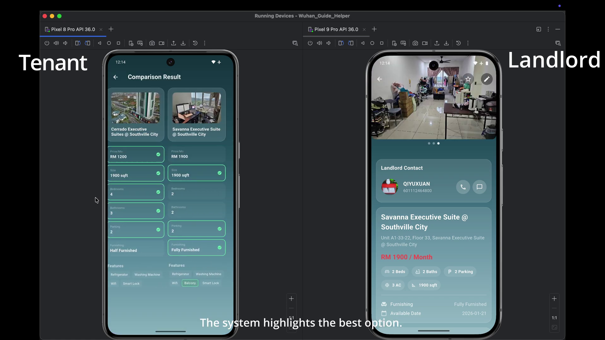 |
| *Tenant property feed with 360° tags & favorite heart*<br>租客端房源推荐流、360° 漫游标识与高对比度红心收藏 | *Automated comparison highlighting best options*<br>多套房源月租、面积、朝向多维对照与优势绿标高亮 |

| 5. Property Detail & Google Maps / 详情与地图 | 6. Viewing Appointment Scheduling / 预约看房 |
|:---:|:---:|
| 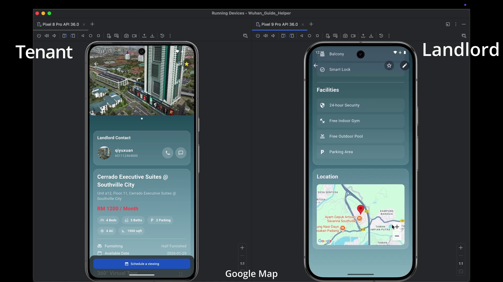 | 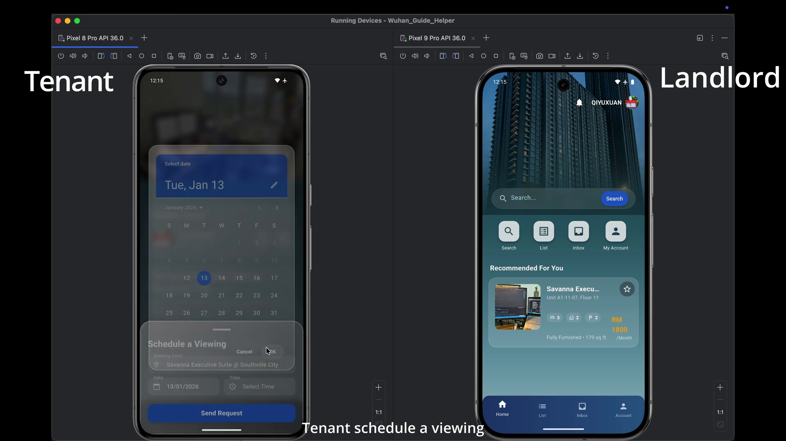 |
| *Interactive Google Maps pins & one-tap phone call*<br>Google Maps 空间定位图钉与房东电话直拨一键唤起 | *In-app appointment booking for in-person inspection*<br>租客选择拟看房日期与时间段，一键直达房东待办 |

| 7. Digital Rental Application / 提交预订申请 | 8. In-App E-Signature Canvas / 手写数字签名 |
|:---:|:---:|
| 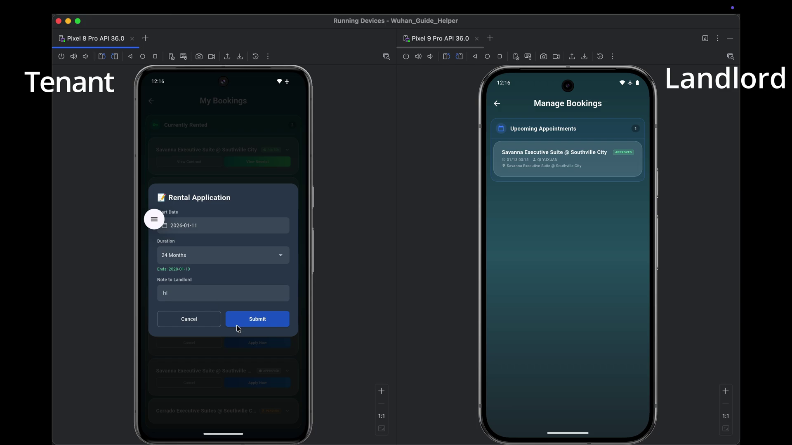 | 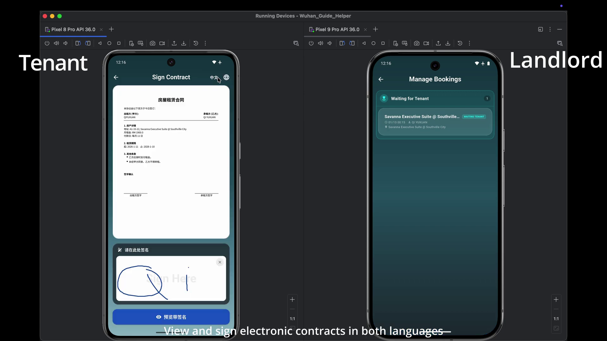 |
| *Tenant formal application with lease duration & notes*<br>租客提交起租日、租期时长 (如 24 个月) 与留言备注 | *Pressure-sensitive digital signature pad with live preview*<br>压感数字签名画板，笔触抗锯齿并实时预览签署位置 |

| 9. Bilingual Legal Contract Review / 双向合同终审 | 10. Stripe In-App Payment Gateway / 在线收银台 |
|:---:|:---:|
| 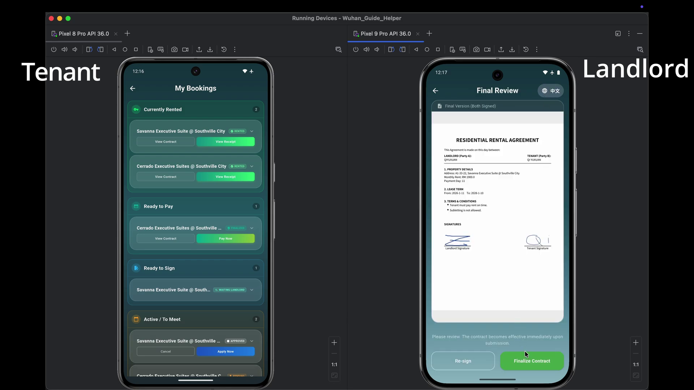 | 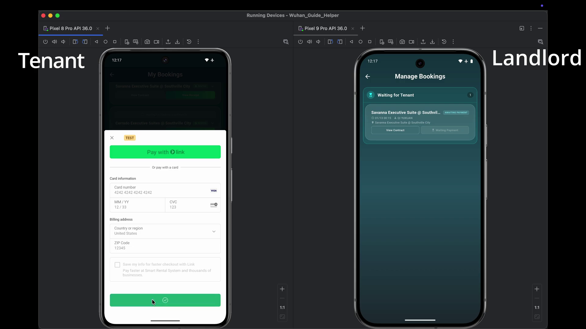 |
| *Both signatures stitched into formal legal PDF*<br>甲乙双方法定签名动态排版合成最终法律效力电子合同 | *Native Stripe Sheet: Credit Card, Link, Apple/Google Pay*<br>Stripe 原生收银台安全缴付首期租金与房屋押金 |

| 11. Instant Digital Receipt / 不可篡改支付收据 | 12. Management Dashboard / 双端资产管理看板 |
|:---:|:---:|
| 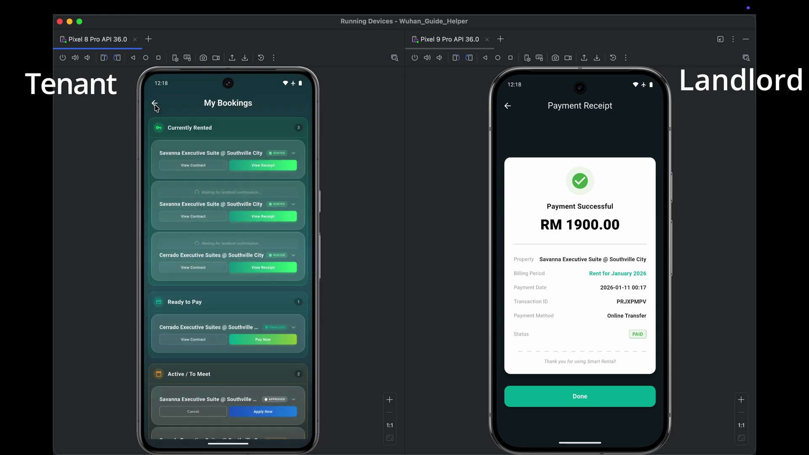 | 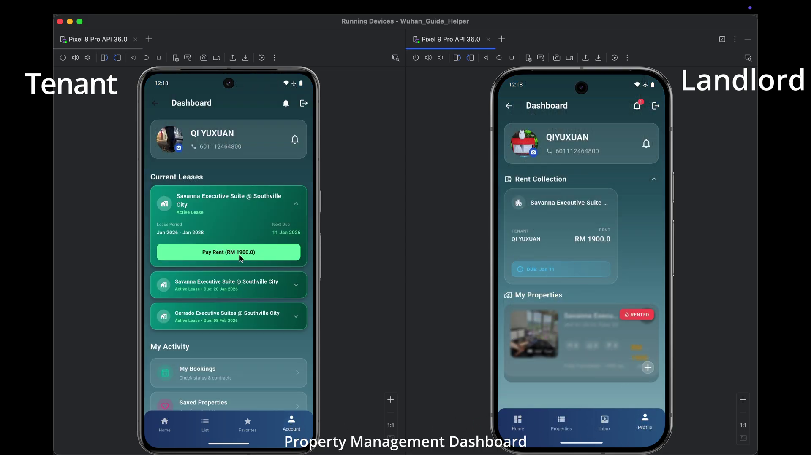 |
| *Verifiable transaction breakdown with Payment Intent ID*<br>包含交易单号、支付日期与状态的法律凭证收据 | *Tenant rent schedule & Landlord collection tracker*<br>租客交租倒计时还款日与房东租金催收全景监控 |

---

## 🌐 Quick Language Navigation
- [🇬🇧 English Documentation](#-english-documentation)
  - [1. Executive Summary](#1-executive-summary)
  - [2. Conceptual Architecture & Data Flow](#2-conceptual-architecture--data-flow)
  - [3. UI/UX Design System & HCI Principles](#3-uiux-design-system--hci-principles)
  - [4. Core Feature Matrix](#4-core-feature-matrix)
  - [5. Cloud Firestore Database Schema](#5-cloud-firestore-database-schema)
  - [6. Project Directory Structure](#6-project-directory-structure)
  - [7. Getting Started & Installation](#7-getting-started--installation)
- [🇨🇳 中文文档](#-中文文档)
  - [1. 项目概览与设计愿景](#1-项目概览与设计愿景)
  - [2. 概念模型与架构设计](#2-概念模型与架构设计)
  - [3. UI / UX 设计系统与人机交互视觉规范](#3-ui--ux-设计系统与人机交互视觉规范)
  - [4. 核心功能矩阵](#4-核心功能矩阵)
  - [5. 云数据库架构设计 (Firestore Schema)](#5-云数据库架构设计-firestore-schema)
  - [6. 项目工程目录结构](#6-项目工程目录结构)
  - [7. 快速开始与环境搭建](#7-快速开始与环境搭建)
- [👨‍💻 Author & License / 作者与开源许可](#-author--license--作者与开源许可)

---

# 🇬🇧 English Documentation

## 1. Executive Summary

**Smart Rental System** is an enterprise-grade, cross-platform property leasing application designed to modernize the traditional rental industry. Engineered using **Flutter**, **Google Cloud Firebase**, and the **Stripe Payment Gateway**, it bridges the trust and operational gaps between **Tenants** and **Landlords** through an intuitive, paperless, and interactive ecosystem.

### Core Problems Solved
- **Misleading Visuals**: Traditional 2D photos often fail to convey actual room geometry. Smart Rental System embeds interactive **360° VR spherical panorama tours**, giving prospective tenants an immersive virtual inspection.
- **Paper Contracts & Fraud**: Physical paper agreements are replaced by in-app **digital canvas e-signatures** and dynamic, tamper-evident legal PDF generation.
- **Opaque Payment Flows**: Integrates the **Stripe Payments SDK**, providing automatic monthly billing schedule calculations, security deposit escrows, and instant digital receipts.
- **Disjointed Communication**: In-app real-time messaging with structured viewing appointment cards ensures direct, documented communication between tenants and landlords.

---

## 2. Conceptual Architecture & Data Flow

The platform centers around a unified **Dashboard Interface** that orchestrates eight core functional subsystems: User Authentication, Profile Management, Property Listing, Landlord Upload, Booking & Application, Contract Management, Real-time Messaging, and Community Feedback.

### 2.1 High-Level Conceptual Diagram


### 2.2 System Architecture & Service Pipeline
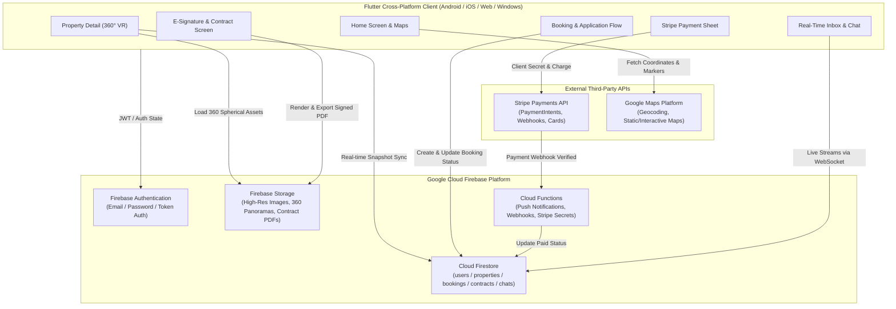

---

## 3. UI/UX Design System & HCI Principles

The visual language combines **Cyber-Aurora Dark aesthetics** with **Frosted Glassmorphism**, engineered following Human-Computer Interaction (HCI) accessibility and cognitive ergonomics guidelines.

### 3.1 Color Palette & Semantic Hierarchy

| Color Name | Hex / Code | Semantic Role & Psychological Association |
|:---|:---|:---|
| **Aurora Dark Background** | `#0E1C22` | Deep slate backdrop; minimizes eye strain and accentuates vibrant property imagery and translucent glass layers. |
| **Glass Card Surface** | `rgba(255, 255, 255, 0.15)` | Frosted glass layer (`BackdropFilter(sigma: 10)`), providing depth, modern aesthetics, and clear content containment. |
| **Trust Blue (Primary)** | `#2563EB` / `#3B82F6` | Primary action buttons, tenant chat bubbles, PDF export actions. Evokes security, reliability, and financial safety. |
| **Accent Red** | `#EF4444` / `#DC2626` | High-contrast favorite heart icon, landlord property deletion, application rejection, and unpaid status warnings. |
| **Success Green** | `#10B981` / `#16A34A` | Approved rental applications, paid invoices, verification badges, and positive system states. |
| **Neutral Gray** | `#6B7280` / `#9CA3AF` | Pending application status, landlord chat bubbles, input borders, and secondary metadata text. |
| **Soft Lavender** | `#EDE9FE` / `#F5F3FF` | Interior form section cards, providing subtle grouping without visual clutter. |

### 3.2 Interactive Component Architecture
- **`GlassCard`**: Universal container applying `BorderRadius.circular(20)` with real-time blur shaders (`ImageFilter.blur(sigmaX: 10, sigmaY: 10)`) and a delicate `0.2` opacity border.
- **`GlowingWrapper`**: Applied to critical CTAs (e.g., signing a contract or paying rent) to guide user focus through soft ambient glow animations.
- **`AnimatedBottomNav`**: Floating navigation capsule with elastic icon transitions and glowing active state indicators.
- **`FadePageTransitionsBuilder`**: Custom cross-platform navigation transition removing harsh platform slide-cuts in favor of buttery-smooth alpha cross-fades.

---

## 4. Core Feature Matrix

### 4.1 360° VR Virtual Room Walkthrough
Powered by `panorama_viewer`, users can virtually inspect any property. Using phone gyroscope tilt controls or touch dragging, tenants can rotate a full 360° sphere to inspect floorings, ceilings, and natural light conditions from anywhere in the world.

### 4.2 Google Maps Geolocation Discovery
Integrated with `google_maps_flutter`, listing addresses are plotted as interactive map pins across Kuala Lumpur, Selangor, and surrounding areas. Tenants can inspect distance to transit hubs, supermarkets, and schools with one-tap directions.

### 4.3 Side-by-Side Property Comparison Matrix
The `CompareScreen` allows tenants to select multiple candidate properties and compare them in an automated matrix, aligning monthly rent, deposit requirements, square footage, furnishing status, and parking availability side by side.

### 4.4 Dual-Persona Rental Lifecycle Workflow
The platform provides strictly partitioned interfaces for Tenants and Landlords:

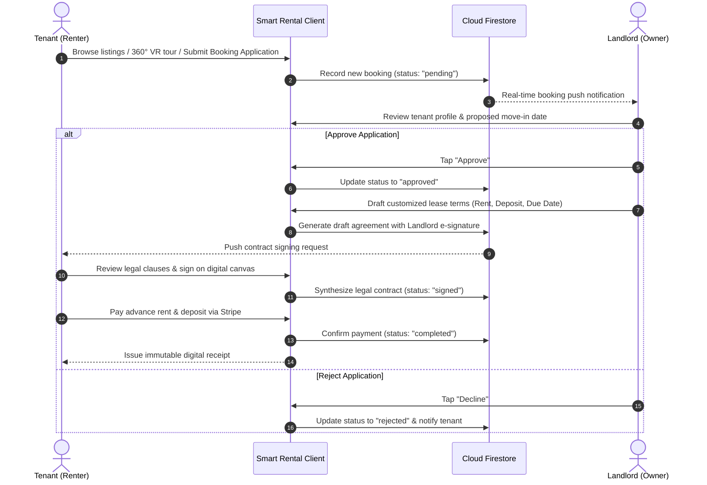

### 4.5 Digital E-Signature & Dynamic Legal PDF Engine
- **Canvas Signature Pad**: High-precision vector signature capture using `signature` with anti-aliasing.
- **Automated PDF Compiler**: Dynamically merges property metadata, landlord/tenant legal names, custom lease terms, timestamps, and digitized signatures into a standard legal document (`pdf` + `printing`).
- **In-App Document Viewer**: Inspect, zoom, export, and print contracts locally using `flutter_pdfview`.

### 4.6 Stripe Financial Payment Gateway & Invoicing
- **Multi-Method Payment Sheet**: Native card inputs, Apple Pay, and Google Pay via `flutter_stripe`.
- **Intelligent Due Date Calculator**: The built-in `_calculateNextDueDate` algorithm tracks the monthly payment day, detects advance payments, and prevents redundant billing.
- **Digital Receipt Generator**: Generates verifiable digital payment receipts on `ReceiptScreen` with Payment Intent IDs and detailed cost breakdowns.

### 4.7 Zero-Disruption Offline Connectivity Guardian
- Implements `ConnectivityNavigationObserver` across all app routes.
- If network connection drops in elevators or basements, `ConnectivityHelper` automatically intercepts critical mutations (submitting applications, payments, or contract signings) with an elegant frosted-glass retry dialog to prevent data loss.

---

## 5. Cloud Firestore Database Schema

```
Cloud Firestore
├── 📁 users (User Accounts & Profiles)
│   └── 📄 {uid}
│       ├── role: "tenant" | "landlord"
│       ├── email: String
│       ├── fullName: String
│       ├── phone: String
│       ├── avatarUrl: String?
│       └── createdAt: Timestamp
│
├── 📁 properties (Rental Property Listings)
│   └── 📄 {propertyId}
│       ├── landlordUid: String
│       ├── title: String
│       ├── description: String
│       ├── rentalPrice: Number
│       ├── depositAmount: Number
│       ├── address: String
│       ├── geoPoint: GeoPoint (latitude, longitude)
│       ├── images: Array<String>
│       ├── panorama360Url: String?
│       ├── amenities: Array<String> (e.g. ["WiFi", "Air Conditioning", "Gym"])
│       ├── isAvailable: Boolean
│       └── createdAt: Timestamp
│
├── 📁 bookings (Lease & Application Lifecycle)
│   └── 📄 {bookingId}
│       ├── propertyId: String
│       ├── landlordUid: String
│       ├── tenantUid: String
│       ├── status: "pending" | "approved" | "rejected" | "signed" | "completed"
│       ├── moveInDate: Timestamp
│       ├── monthlyPaymentDay: Number (1-31)
│       ├── lastPaymentDate: Timestamp?
│       ├── isReadByTenant: Boolean
│       ├── isReadByLandlord: Boolean
│       └── contractPdfUrl: String?
│
├── 📁 chats (Real-Time Messaging Threads)
│   └── 📄 {conversationId}
│       ├── participants: Array<String>
│       ├── lastMessage: String
│       ├── lastTimestamp: Timestamp
│       └── 📁 messages (Subcollection)
│           └── 📄 {messageId}
│               ├── senderUid: String
│               ├── text: String
│               └── timestamp: Timestamp
│
└── 📁 favorites (Tenant Watchlists)
    └── 📄 {favoriteId}
        ├── tenantUid: String
        ├── propertyId: String
        └── addedAt: Timestamp
```

---

## 6. Project Directory Structure

```
smart_rental_system/
├── android/                        # Android native configurations & build scripts
├── ios/                            # iOS native configurations & Podfile
├── web/                            # Web platform support
├── windows/                        # Windows desktop support
├── assets/                         # Static application assets
│   └── images/
│       ├── my_logo.png             # Application logo
│       ├── mainPageBackGround.png  # High-definition aurora backdrop
│       └── fonts/                  # Offline Noto Sans & Noto Sans SC fonts
├── docs/                           # Documentation and visual diagrams
│   └── images/
│       ├── smart_rental_conceptual_diagram.png # Architecture model diagram
│       └── screenshots/            # High-resolution production UI keyframes
├── lib/                            # Dart / Flutter core source code
│   ├── main.dart                   # Main entry, theme setup & network observer
│   ├── Compoents/                  # Reusable UI component library
│   │   ├── animated_bottom_nav.dart            # Floating animated navigation bar
│   │   ├── glass_card.dart                     # Core frosted glass container
│   │   ├── glass_dialog_helper.dart            # Frosted glass dialog helper
│   │   ├── glowing_wrapper.dart                # Ambient glowing visual wrapper
│   │   ├── fade_transition_builder.dart        # Seamless alpha fade transitions
│   │   ├── panorama_widget.dart                # 360° VR room inspection widget
│   │   ├── property_card.dart                  # Discovery feed listing card
│   │   ├── favorite_button.dart                # High-contrast reactive heart button
│   │   ├── filter_modal.dart                   # Multi-criteria filter bottom sheet
│   │   ├── contract_generator.dart             # PDF lease contract generator
│   │   ├── shared_contract_signing_screen.dart # Digital e-signature pad
│   │   ├── landlord_booking_card.dart          # Landlord booking decision card
│   │   ├── tenant_booking_card.dart            # Tenant active lease status card
│   │   ├── meeting_card.dart                   # Structured viewing appointment card
│   │   ├── inbox_message_card.dart             # Real-time inbox chat preview card
│   │   └── user_info_card.dart                 # User profile metadata card
│   ├── Screens/                    # View screens & application pages
│   │   ├── splash_screen.dart                  # Animated application splash
│   │   ├── login_screen.dart                   # User authentication
│   │   ├── register_screen.dart                # Role-based registration
│   │   ├── forgot_password_screen.dart         # Password recovery
│   │   ├── home_screen.dart                    # Tenant discovery hub
│   │   ├── property_list_screen.dart           # Search results & filtering
│   │   ├── property_detail_screen.dart         # 360 VR, Google Maps, listing specs
│   │   ├── compare_screen.dart                 # Side-by-side comparison matrix
│   │   ├── favorite_screen.dart                # Tenant saved watchlist
│   │   ├── add_property_screen.dart            # Landlord property uploader
│   │   ├── landlord_screen.dart                # Landlord management dashboard
│   │   ├── landlord_bookings_screen.dart       # Booking review & approval flow
│   │   ├── landlord_inbox_screen.dart          # Landlord messaging center
│   │   ├── tenant_screen.dart                  # Tenant active lease dashboard
│   │   ├── tenant_bookings_screen.dart         # Tenant bookings & payment center
│   │   ├── final_contract_viewer_screen.dart   # Signed legal contract PDF viewer
│   │   └── receipt_screen.dart                 # Digital payment receipt screen
│   └── Services/                   # Core platform services & API handlers
│       ├── auth_gate.dart                      # Authentication state router
│       ├── favorite_service.dart               # Cloud Firestore favorite sync
│       ├── pdf_services.dart                   # PDF generation & storage handler
│       ├── storage_service.dart                # Firebase Storage media uploader
│       ├── stripe_service.dart                 # Stripe payment intent gateway
│       ├── connectivity_helper.dart            # Real-time network health monitor
│       └── firebase_options.dart               # Multi-platform Firebase credentials
├── pubspec.yaml                    # Flutter package manifests & dependencies
└── README.md                       # Complete bilingual system documentation
```

---

## 7. Getting Started & Installation

### 7.1 Prerequisites
- [Flutter SDK](https://docs.flutter.dev/get-started/install) ($\ge 3.4.0$)
- [Dart SDK](https://dart.dev/get-dart) ($\ge 3.4.0 < 4.0.0$)
- For Android: Android Studio with Android SDK API Level $\ge 21$
- For iOS: macOS with Xcode $\ge 15$ and CocoaPods

### 7.2 Installation
```bash
git clone https://github.com/MOYUNXUAN4/smart_rental_system.git
cd smart_rental_system

# Install pub packages
flutter pub get
```

### 7.3 Firebase Setup
Generate your own `firebase_options.dart` if connecting to a personal project:
```bash
dart pub global activate flutterfire_cli
flutterfire configure
```
Enable the following in your Firebase Console:
1. **Authentication**: Enable Email/Password provider.
2. **Cloud Firestore**: Create database in production mode with proper security rules.
3. **Cloud Storage**: Enable storage bucket for images, 360 VR panoramas, and PDFs.

### 7.4 Stripe API Key Setup
Configure your publishable key in `lib/main.dart`:
```dart
Stripe.publishableKey = 'pk_test_your_stripe_publishable_key';
await Stripe.instance.applySettings();
```

### 7.5 Google Maps API Setup
- **Android**: Add your API Key inside `android/app/src/main/AndroidManifest.xml`:
  ```xml
  <meta-data
      android:name="com.google.android.geo.API_KEY"
      android:value="YOUR_GOOGLE_MAPS_API_KEY"/>
  ```
- **iOS**: Register your API key in `ios/Runner/AppDelegate.swift`:
  ```swift
  GMSServices.provideAPIKey("YOUR_GOOGLE_MAPS_API_KEY")
  ```

### 7.6 Launching the App
```bash
# Run on connected device or emulator
flutter run

# Run on specific target
flutter run -d chrome
flutter run -d windows
```

---

# 🇨🇳 中文文档

## 1. 项目概览与设计愿景

**Smart Rental System (智能房屋租赁平台)** 是一套基于 **Flutter 跨平台框架**、**Google Firebase 云原生服务** 与 **Stripe 国际在线支付网关** 构建的全功能闭环智慧租房生态系统。

### 行业痛点与解决策略
1. **房源信息虚假与空间失真**：传统静态图片拍摄角度受限，本项目内置 **360° VR 室内全景图交互漫游**，足不出户即可远程沉浸式检验房间真实格局与采光。
2. **纸质合同签署繁琐与纠纷**：告别繁重低效的线下纸质签约，内置 **手写压感数字签名画板**，全自动排版生成具备防伪时间戳与条款的合规 **PDF 电子租赁合同**。
3. **跨行转账低效与对账困难**：全面集成 **Stripe 国际金融级支付 SDK**，自动化计算次月应缴还款日，支持一键缴付租金与押金并出具不可篡改电子收据。
4. **租后沟通断层**：提供房东与租客点对点即时通讯聊天室与结构化看房预约卡片，实现全周期留痕与透明沟通。

---

## 2. 概念模型与架构设计

系统以模块化、高内聚、低耦合为设计原则，围绕总控看板（Dashboard Interface）协调调度八大业务子系统：用户认证、个人档案、房源展示、房东上传、预订申请、租约管理、即时通信与评价反馈。

### 2.1 架构概念模型图


### 2.2 双角色全生命周期租赁闭环流程
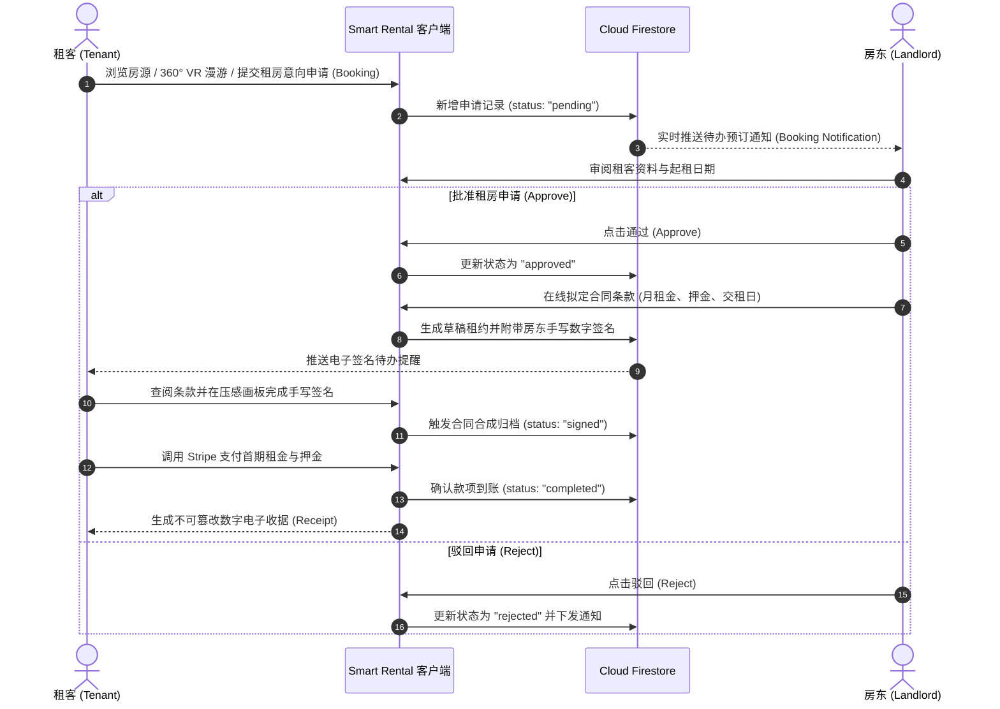

---

## 3. UI / UX 设计系统与人机交互视觉规范

基于人机交互（HCI）与用户体验认知心理学准则，系统采用现代**赛博极光暗色调（Cyber-Aurora Dark）**与**高透毛玻璃拟态（Frosted Glassmorphism）**相互交融的设计语言，营造安全、专业、高级的数字化金融租赁质感。

### 3.1 语义调色板规范 (Semantic Color Palette)

| 颜色名称 | 十六进制色值 | 界面语义与交互心理学设计意图 |
|:---|:---|:---|
| **极光暗调主背景** | `#0E1C22` (`Scaffold Background`) | 消除刺眼高亮背景，凸显房源高饱和度图像与毛玻璃层次，提供沉浸感。 |
| **毛玻璃卡片基底** | `rgba(255, 255, 255, 0.15)` | `GlassCard` 核心容器，配合高斯模糊（`sigma: 10`），呈现深邃亚克力层次。 |
| **安全信任蓝 (Trust Blue)** | `#2563EB` / `#3B82F6` | **主行动按钮、租客消息气泡、PDF下载按钮**。传递金融合规、信赖与操作确定感。 |
| **醒目高对比红 (Accent Red)** | `#EF4444` / `#DC2626` | **收藏夹红心 (高对比度一键定位)**、房东删除房源、驳回申请与未付款警告。 |
| **合规成功绿 (Success Green)** | `#10B981` / `#16A34A` | **申请已批准 (Approved)**、租金已缴清 (Paid)、操作成功指示。 |
| **沉稳待定灰 (Neutral Gray)** | `#6B7280` / `#9CA3AF` | **申请审核中 (Pending)**、房东消息气泡、次要描述与输入框占位符。 |
| **优雅薰衣草紫 (Soft Lavender)** | `#EDE9FE` / `#F5F3FF` | 表单板块内嵌卡片，轻度分隔填写区域，避免单一色系审美疲劳。 |

### 3.2 核心可复用 UI 组件与微动画
- **`GlassCard` (毛玻璃核心容器)**：全站统一圆角（`BorderRadius.circular(20)`）与亚克力高斯模糊（`ImageFilter.blur(sigmaX: 10, sigmaY: 10)`），辅以 `0.2` 透明度白细边框。
- **`GlowingWrapper` (霓虹呼吸光晕)**：对核心操作项（如签约确认、支付通道）施加动态外发光微动效。
- **`AnimatedBottomNav` (悬浮动态导航栏)**：底栏浮空于页面之上，切换页面时图标伴随弹性缩放与光点跟随反馈。
- **`FadePageTransitionsBuilder` (无缝渐变转场)**：全系统采用平滑淡入淡出（Cross-Fade）转场，避免原生平台生硬的推屏切割感。

---

## 4. 核心功能矩阵

### 4.1 360° VR 全景虚拟看房 (Virtual Panorama Tour)
- 集成 `panorama_viewer` 高性能 WebGL / OpenGL 球面着色器；
- 租客只需滑动屏幕或倾斜手机（配合重力感应陀螺仪），即可 360° 无死角沉浸式审视客厅、卧室、卫浴真实空间格局，彻底颠覆传统二维照片拍摄角度失真的局限。

### 4.2 Google Maps 空间地理房源检索 (Geolocation Search)
- 深度整合 `google_maps_flutter`，将房源真实经纬度渲染为地图交互图钉（Pins）；
- 支持拖拽缩放、一键定位（默认覆盖吉隆坡与周边重点商圈）、点击图钉弹出紧凑型房源悬浮预览卡片并直接唤起导航。

### 4.3 多维度房源对比矩阵 (Property Comparison Tool)
- 租客选定多套心仪房源后，可在 `CompareScreen` 生成横向对照矩阵；
- 针对月租金、押金金额、面积大小、装修情况、车位配备、家电清单等核心指标做逐行对齐，辅助做出最优租房决策。

### 4.4 电子签名与动态 PDF 租赁合同生成 (Digital E-Signature & Legal PDF)
- **手写交互画板**：基于 `signature` 组件提供高灵敏度压感贝塞尔曲线签字画板，支持一键清空与笔触抗锯齿；
- **动态合同渲染**：利用 `pdf` 与 `printing` 库，在移动端动态将房东/租客信息、条款正文、手写笔迹图片、时间戳与唯一防伪哈希排版合成为标准的合规 PDF 文件；
- **内嵌 PDF 阅读器**：使用 `flutter_pdfview` 无需跳出应用即可原地全屏预览、缩放并支持导出与打印。

### 4.5 Stripe 金融级在线租金与押金网关 (Stripe Payment & Invoicing)
- **多币种支持**：通过官方 `flutter_stripe` SDK 唤起原生支付面板（PaymentSheet），支持信用卡、借记卡、Google Pay 与 Apple Pay；
- **智能账单推算器**：内置 `_calculateNextDueDate` 算法，依据起租日与账单周期自动推算每月应缴还款日，支持识别提前还款并避免重复出账；
- **电子支付凭证**：支付成功后自动生成附带交易单号（Payment Intent ID）、房源明细与时间戳的电子收据界面（`ReceiptScreen`）。

### 4.6 实时即时通讯与看房预约 (Real-Time Chat & Meetings)
- 租客与房东可通过内置的实时消息信箱（Inbox）进行点对点咨询；
- 遵循聊天气泡视觉规范：租客发言使用信任蓝气泡，房东回复使用沉稳灰气泡；
- 内置 `MeetingCard` 结构化看房预约组件，直接在会话流中确认线下/线上实地看房时间。

### 4.7 全局断网无感拦截卫士 (Zero-Disruption Connectivity Guardian)
- 针对移动租房场景下的地下室、电梯等弱网痛点，系统实现 `ConnectivityNavigationObserver` 全局路由监听；
- 路由切换或关键操作前，自动调用 `ConnectivityHelper` 嗅探网络连通状态；若检测断网，即刻以优雅的毛玻璃弹窗拦截高危操作（如提交申请、签约、付款），防止状态不同步与丢单。

---

## 5. 云数据库架构设计 (Firestore Schema)

```
Cloud Firestore
├── 📁 users (用户账户表)
│   └── 📄 {uid}
│       ├── role: "tenant" | "landlord"
│       ├── email: String
│       ├── fullName: String
│       ├── phone: String
│       ├── avatarUrl: String?
│       └── createdAt: Timestamp
│
├── 📁 properties (房源数据表)
│   └── 📄 {propertyId}
│       ├── landlordUid: String
│       ├── title: String
│       ├── description: String
│       ├── rentalPrice: Number
│       ├── depositAmount: Number
│       ├── address: String
│       ├── geoPoint: GeoPoint (latitude, longitude)
│       ├── images: Array<String>
│       ├── panorama360Url: String?
│       ├── amenities: Array<String> (e.g. ["WiFi", "空调", "独立卫浴"])
│       ├── isAvailable: Boolean
│       └── createdAt: Timestamp
│
├── 📁 bookings (预订与租赁全生命周期表)
│   └── 📄 {bookingId}
│       ├── propertyId: String
│       ├── landlordUid: String
│       ├── tenantUid: String
│       ├── status: "pending" | "approved" | "rejected" | "signed" | "completed"
│       ├── moveInDate: Timestamp
│       ├── monthlyPaymentDay: Number (1-31)
│       ├── lastPaymentDate: Timestamp?
│       ├── isReadByTenant: Boolean
│       ├── isReadByLandlord: Boolean
│       └── contractPdfUrl: String?
│
├── 📁 chats (即时聊天会话表)
│   └── 📄 {conversationId}
│       ├── participants: Array<String>
│       ├── lastMessage: String
│       ├── lastTimestamp: Timestamp
│       └── 📁 messages (子集合)
│           └── 📄 {messageId}
│               ├── senderUid: String
│               ├── text: String
│               └── timestamp: Timestamp
│
└── 📁 favorites (租客收藏夹)
    └── 📄 {favoriteId}
        ├── tenantUid: String
        ├── propertyId: String
        └── addedAt: Timestamp
```

---

## 6. 项目工程目录结构

```
smart_rental_system/
├── android/                        # Android 原生平台配置与工程
├── ios/                            # iOS 原生平台配置与 Podfile
├── web/                            # Web 平台支持
├── windows/                        # Windows 桌面平台支持
├── assets/                         # 本地静态资源目录
│   └── images/
│       ├── my_logo.png             # 应用主 Logo 标识
│       ├── mainPageBackGround.png  # 登录页全高清极光背景图
│       └── fonts/                  # 国际化离线字体资源
│           ├── NotoSans-Regular.ttf
│           ├── NotoSansSC-Regular.ttf
│           └── NotoSansSC-Bold.ttf
├── docs/                           # 文档与架构图资源
│   └── images/
│       ├── smart_rental_conceptual_diagram.png # 概念架构模型图
│       └── screenshots/            # 1080P 高清实机运行截图
├── lib/                            # Flutter 核心业务源码
│   ├── main.dart                   # 应用入口、全局主题与网络监听初始化
│   ├── Compoents/                  # 可复用 UI 组件库
│   │   ├── animated_bottom_nav.dart            # 动态悬浮底栏
│   │   ├── glass_card.dart                     # 核心毛玻璃卡片
│   │   ├── glass_dialog_helper.dart            # 毛玻璃模态弹窗辅助类
│   │   ├── glowing_wrapper.dart                # 霓虹光晕动效包裹器
│   │   ├── fade_transition_builder.dart        # 页面交叉淡入淡出转场
│   │   ├── panorama_widget.dart                # 360° VR 室内全景图渲染组件
│   │   ├── property_card.dart                  # 首页瀑布流房源卡片
│   │   ├── favorite_button.dart                # 收藏心形按钮组件
│   │   ├── filter_modal.dart                   # 多维度条件筛选抽屉
│   │   ├── contract_generator.dart             # PDF 租赁合同生成器
│   │   ├── shared_contract_signing_screen.dart # 电子手写签名交互面板
│   │   ├── landlord_booking_card.dart          # 房东端租约申请处理卡片
│   │   ├── tenant_booking_card.dart            # 租客端申请跟踪卡片
│   │   ├── meeting_card.dart                   # 结构化看房预约卡片
│   │   ├── inbox_message_card.dart             # 信箱消息卡片
│   │   └── user_info_card.dart                 # 用户资料状态卡片
│   ├── Screens/                    # 业务视图页面
│   │   ├── splash_screen.dart                  # 动态启动画面
│   │   ├── login_screen.dart                   # 账号登录
│   │   ├── register_screen.dart                # 角色注册 (租客/房东)
│   │   ├── forgot_password_screen.dart         # 密码重置找回
│   │   ├── home_screen.dart                    # 租客主看板与推荐流
│   │   ├── property_list_screen.dart           # 房源搜索与列表呈现
│   │   ├── property_detail_screen.dart         # 房源详情页 (360VR/地图/预约)
│   │   ├── compare_screen.dart                 # 房源横向对比矩阵
│   │   ├── favorite_screen.dart                # 租客个人收藏夹
│   │   ├── add_property_screen.dart            # 房东发布房源 (多图/全景上传)
│   │   ├── landlord_screen.dart                # 房东管理主看板
│   │   ├── landlord_bookings_screen.dart       # 房东申请决策管理
│   │   ├── landlord_inbox_screen.dart          # 房东即时通信会话中心
│   │   ├── tenant_screen.dart                  # 租客管理主看板
│   │   ├── tenant_bookings_screen.dart         # 租客在租中房源与账单中心
│   │   ├── final_contract_viewer_screen.dart   # 签约完成 PDF 归档查阅器
│   │   └── receipt_screen.dart                 # 支付成功收据凭证页
│   └── Services/                   # 核心业务服务与网关
│       ├── auth_gate.dart                      # Firebase 鉴权状态守卫路由
│       ├── favorite_service.dart               # 收藏夹读写服务
│       ├── pdf_services.dart                   # PDF 引擎与文件存储管理
│       ├── storage_service.dart                # Firebase Storage 云存储上传
│       ├── stripe_service.dart                 # Stripe 国际在线支付网关
│       ├── connectivity_helper.dart            # 网络连通性健康探测
│       └── firebase_options.dart               # 多平台 Firebase 初始化凭据
├── pubspec.yaml                    # 项目依赖管理与资源配置清单
└── README.md                       # 项目完整中英文双语使用与技术规格说明书
```

---

## 7. 快速开始与环境搭建

### 7.1 开发环境要求
- [Flutter SDK](https://docs.flutter.dev/get-started/install) (版本 $\ge 3.4.0$)
- [Dart SDK](https://dart.dev/get-dart) (版本 $\ge 3.4.0 < 4.0.0$)
- 针对 Android 开发：Android Studio / Android SDK (API Level $\ge 21$)
- 针对 iOS 开发：macOS 系统、Xcode $\ge 15$ 及 CocoaPods

### 7.2 克隆代码与依赖下载
```bash
git clone https://github.com/MOYUNXUAN4/smart_rental_system.git
cd smart_rental_system

# 获取 pub 依赖项
flutter pub get
```

### 7.3 Firebase 云服务初始化
若需接入您个人创建的 Firebase 项目：
```bash
dart pub global activate flutterfire_cli
flutterfire configure
```
并在 Firebase 控制台依次开启：
1. **Authentication**：启用 Email/Password 认证；
2. **Cloud Firestore**：创建默认数据库；
3. **Cloud Storage**：开启存储桶供房源图片、全景图与合同 PDF 存取。

### 7.4 Stripe 在线支付密钥配置
在 `lib/main.dart` 中替换为您专属的 Stripe Publishable Key：
```dart
Stripe.publishableKey = 'pk_test_your_stripe_publishable_key';
await Stripe.instance.applySettings();
```

### 7.5 Google Maps API 密钥设置
- **Android**：在 `android/app/src/main/AndroidManifest.xml` 中配置：
  ```xml
  <meta-data
      android:name="com.google.android.geo.API_KEY"
      android:value="YOUR_GOOGLE_MAPS_API_KEY"/>
  ```
- **iOS**：在 `ios/Runner/AppDelegate.swift` 中调用：
  ```swift
  GMSServices.provideAPIKey("YOUR_GOOGLE_MAPS_API_KEY")
  ```

### 7.6 编译与运行
```bash
# 启动本地设备选择器并调试运行
flutter run

# 或直接指定平台 (如 Chrome / Windows 桌面端)
flutter run -d chrome
flutter run -d windows
```

---

## 👨‍💻 Author & License / 作者与开源许可

- **Author / 作者**：**MOYUNXUAN**
- **License / 开源协议**：[MIT License](LICENSE). Free for personal, academic, and commercial study. / 欢迎自由学习、研究、扩展与提交 Pull Request！
- **GitHub Repository / 官方仓库**：[https://github.com/MOYUNXUAN4/smart_rental_system](https://github.com/MOYUNXUAN4/smart_rental_system)
- **Demo Video / 演示视频**：[YouTube Live Demo (https://youtu.be/iYnOc6fSKF4)](https://youtu.be/iYnOc6fSKF4)
