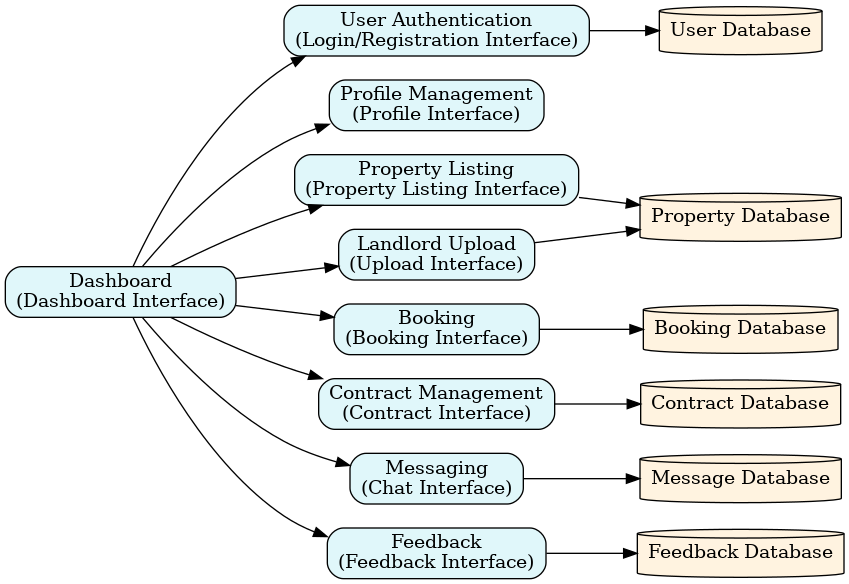
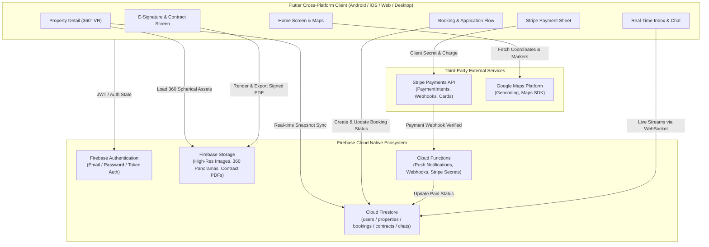
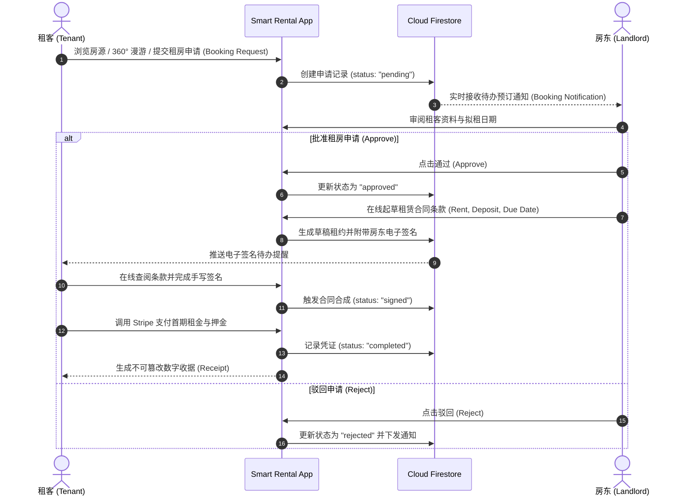

# Smart Rental System 🏡✨
### *Next-Generation Intelligent Property Leasing Platform Powered by Flutter, Firebase & Stripe*

[](https://flutter.dev/)
[](https://dart.dev/)
[-orange.svg?logo=firebase)](https://firebase.google.com/)
[](https://stripe.com/)
[](https://developers.google.com/maps)
[]()
[]()
[](LICENSE)
[]()

---

## 📖 目录 (Table of Contents)
- [📌 项目概览 (System Overview)](#-项目概览-system-overview)
- [📐 架构设计与概念模型 (Conceptual Architecture)](#-架构设计与概念模型-conceptual-architecture)
- [🎨 UI / UX 设计系统与视觉规范 (UI/UX Design System)](#-ui--ux-设计系统与视觉规范-uiux-design-system)
- [✨ 核心功能矩阵 (Key Features)](#-核心功能矩阵-key-features)
  - [1. 360° VR 全景虚拟看房 (Virtual Panorama Tour)](#1-360-vr-全景虚拟看房-virtual-panorama-tour)
  - [2. Google Maps 空间地理房源检索 (Geolocation Search)](#2-google-maps-空间地理房源检索-geolocation-search)
  - [3. 多维度房源对比矩阵 (Property Comparison Tool)](#3-多维度房源对比矩阵-property-comparison-tool)
  - [4. 双角色全生命周期租赁流 (Dual-Persona Leasing Lifecycle)](#4-双角色全生命周期租赁流-dual-persona-leasing-lifecycle)
  - [5. 电子签名与动态 PDF 租赁合同生成 (Digital E-Signature & Legal PDF)](#5-电子签名与动态-pdf-租赁合同生成-digital-e-signature--legal-pdf)
  - [6. Stripe 金融级在线租金与押金网关 (Stripe Payment & Invoicing)](#6-stripe-金融级在线租金与押金网关-stripe-payment--invoicing)
  - [7. 实时即时通讯与看房预约 (Real-Time Chat & Meetings)](#7-实时即时通讯与看房预约-real-time-chat--meetings)
  - [8. 全局断网无感拦截卫士 (Zero-Disruption Connectivity Guardian)](#8-全局断网无感拦截卫士-zero-disruption-connectivity-guardian)
- [🗄️ 数据库架构设计 (Firestore Database Schema)](#️-数据库架构设计-firestore-database-schema)
- [📂 项目目录结构 (Directory Structure)](#-项目目录结构-directory-structure)
- [🚀 快速开始与环境搭建 (Getting Started)](#-快速开始与环境搭建-getting-started)
- [👨‍💻 作者与开源许可 (Author & License)](#-作者与开源许可-author--license)

---

## 📌 项目概览 (System Overview)

**Smart Rental System (智能房屋租赁平台)** 是一套基于 **Flutter 跨平台框架**、**Google Firebase 云原生服务** 与 **Stripe 国际在线支付网关** 构建的全功能闭环智慧租房生态系统。

传统房屋租赁行业普遍存在信息碎片化、纸质合同签署繁琐、跨行支付对账困难、房源展示单一（静态图片失真）等行业痛点。Smart Rental System 以**以用户为中心的设计（User-Centered Design, UCD）**为核心理念，深度整合现代软硬件协同能力：
- **租客视角 (Tenant)**：享受沉浸式 360° VR 室内漫游、地图找房、横向参数比对、一键意向申请、在线手写数字签名及银行卡/信用卡一键缴付租金与押金。
- **房东视角 (Landlord)**：享受全生命周期资产管理看板、移动端房源发布与相册管理、租客申请审批/驳回决策流、自动化电子租约生成、账单收款确认与租约归档管理。

---

## 📐 架构设计与概念模型 (Conceptual Architecture)

系统遵循模块化分层解耦架构，围绕统一的仪表盘（Dashboard Interface）协同调度用户认证、资料管理、房源展示、房东上传、租赁意向预订、电子合同、即时通信及评价反馈八大子系统。

### 1. 概念模型图 (Conceptual Diagram)


### 2. 端到端数据交互全景流程


---

## 🎨 UI / UX 设计系统与视觉规范 (UI/UX Design System)

系统的 UI 交互规范经过人机交互（HCI）实验论证，采用现代**赛博极光暗色调（Cyber-Aurora Dark）**与**毛玻璃拟态（Frosted Glassmorphism）**的有机结合，营造安全、专业、高级的现代数字化金融租赁质感。

### 1. 核心调色板规范 (Semantic Color Palette)

| 色彩类型 | 色值代码 (Hex / RGBA) | 视觉语义与应用场景 |
|:---|:---|:---|
| **极光暗调主背景** | `#0E1C22` (`Scaffold Background`) | 消除强光刺激，凸显房源高饱和度图像与毛玻璃层次，提供沉浸感。 |
| **毛玻璃卡片基底** | `rgba(255, 255, 255, 0.15)` | `GlassCard` 核心组件，配合 `BackdropFilter(sigma: 10)`，构建深邃层次感。 |
| **安全信任蓝 (Trust Blue)** | `#2563EB` / `#3B82F6` | **主交互按钮、租客气泡、PDF下载按钮**。传递金融合规、严谨与信赖感。 |
| **醒目活力红 (Accent Red)** | `#EF4444` / `#DC2626` | **收藏心形按钮 (高对比度识别)**、房东删除房源、驳回申请、未付款状态标。 |
| **合规成功绿 (Success Green)** | `#10B981` / `#16A34A` | **申请已批准 (Approved)**、租金已缴清 (Paid)、操作成功提示。 |
| **沉稳待定灰 (Neutral Gray)** | `#6B7280` / `#9CA3AF` | **申请审核中 (Pending)**、房东聊天气泡、次要描述与输入框占位符。 |
| **优雅薰衣草紫 (Soft Lavender)** | `#EDE9FE` / `#F5F3FF` | 表单板块内嵌卡片，轻度分隔填写区域，避免单一色系审美疲劳。 |

### 2. 组件交互与微动画设计 (UI Components)
- **`GlassCard` (毛玻璃核心容器)**：全站统一圆角（`BorderRadius.circular(20)`）与亚克力高斯模糊（`ImageFilter.blur(sigmaX: 10, sigmaY: 10)`），辅以 `0.2` 透明度白细边框。
- **`GlowingWrapper` (霓虹呼吸光晕)**：对核心操作项（如签约确认、支付通道）施加动态外发光微动效。
- **`AnimatedBottomNav` (悬浮动态导航栏)**：底栏浮空于页面之上，切换页面时图标伴随弹性缩放与光点跟随反馈。
- **`FadePageTransitionsBuilder` (无缝渐变转场)**：全系统采用平滑淡入淡出（Cross-Fade）转场，避免原生平台生硬的推屏切割感。

---

## ✨ 核心功能矩阵 (Key Features)

### 1. 360° VR 全景虚拟看房 (Virtual Panorama Tour)
- 集成 `panorama_viewer` 高性能 WebGL / OpenGL 球面着色器；
- 租客只需滑动屏幕或倾斜手机（配合重力感应陀螺仪），即可 360° 无死角沉浸式审视客厅、卧室、卫浴真实空间格局，彻底颠覆传统二维照片拍摄角度失真的局限。

### 2. Google Maps 空间地理房源检索 (Geolocation Search)
- 深度整合 `google_maps_flutter`，将房源真实经纬度渲染为地图交互图钉（Pins）；
- 支持拖拽缩放、一键定位（默认覆盖吉隆坡与周边重点商圈）、点击图钉弹出紧凑型房源悬浮预览卡片并直接唤起导航。

### 3. 多维度房源对比矩阵 (Property Comparison Tool)
- 租客选定多套心仪房源后，可在 `CompareScreen` 生成横向对照矩阵；
- 针对月租金、押金金额、面积大小、装修情况、车位配备、家电清单等核心指标做逐行对齐，辅助做出最优租房决策。

### 4. 双角色全生命周期租赁流 (Dual-Persona Leasing Lifecycle)
系统严格隔离租客（Tenant）与房东（Landlord）的操作权限，打造无缝交互闭环：



### 5. 电子签名与动态 PDF 租赁合同生成 (Digital E-Signature & Legal PDF)
- **手写交互画板**：基于 `signature` 组件提供高灵敏度压感贝塞尔曲线签字画板，支持一键清空与笔触抗锯齿；
- **动态合同渲染**：利用 `pdf` 与 `printing` 库，在移动端动态将房东/租客信息、条款正文、手写笔迹图片、时间戳与唯一防伪哈希排版合成为标准的合规 PDF 文件；
- **内嵌 PDF 阅读器**：使用 `flutter_pdfview` 无需跳出应用即可原地全屏预览、缩放并支持导出与打印。

### 6. Stripe 金融级在线租金与押金网关 (Stripe Payment & Invoicing)
- **多币种支持**：通过官方 `flutter_stripe` SDK 唤起原生支付面板（PaymentSheet），支持信用卡、借记卡、Google Pay 与 Apple Pay；
- **智能账单推算器**：内置 `_calculateNextDueDate` 算法，依据起租日与账单周期自动推算每月应缴还款日，支持识别提前还款并避免重复出账；
- **电子支付凭证**：支付成功后自动生成附带交易单号（Payment Intent ID）、房源明细与时间戳的电子收据界面（`ReceiptScreen`）。

### 7. 实时即时通讯与看房预约 (Real-Time Chat & Meetings)
- 租客与房东可通过内置的实时消息信箱（Inbox）进行点对点咨询；
- 遵循聊天气泡视觉规范：租客发言使用信任蓝气泡，房东回复使用沉稳灰气泡；
- 内置 `MeetingCard` 结构化看房预约组件，直接在会话流中确认线下/线上实地看房时间。

### 8. 全局断网无感拦截卫士 (Zero-Disruption Connectivity Guardian)
- 针对移动租房场景下的地下室、电梯等弱网痛点，系统实现 `ConnectivityNavigationObserver` 全局路由监听；
- 路由切换或关键操作前，自动调用 `ConnectivityHelper` 嗅探网络连通状态；若检测断网，即刻以优雅的毛玻璃弹窗拦截高危操作（如提交申请、签约、付款），防止状态不同步与丢单。

---

## 🗄️ 数据库架构设计 (Firestore Database Schema)

系统采用 NoSQL 文档型数据库架构，核心集合（Collections）定义如下：

```
Cloud Firestore
├── 📁 users (用户账户表)
│   └── 📄 {uid}
│       ├── role: "tenant" | "landlord"
│       ├── email: String
│       ├── fullName: String
│       ├── phone: String
│       ├── avatarUrl: String?
│       └── createdAt: Timestamp
│
├── 📁 properties (房源数据表)
│   └── 📄 {propertyId}
│       ├── landlordUid: String
│       ├── title: String
│       ├── description: String
│       ├── rentalPrice: Number
│       ├── depositAmount: Number
│       ├── address: String
│       ├── geoPoint: GeoPoint (latitude, longitude)
│       ├── images: Array<String>
│       ├── panorama360Url: String?
│       ├── amenities: Array<String> (e.g. ["WiFi", "AC", "Furnished"])
│       ├── isAvailable: Boolean
│       └── createdAt: Timestamp
│
├── 📁 bookings (预订与租赁全生命周期表)
│   └── 📄 {bookingId}
│       ├── propertyId: String
│       ├── landlordUid: String
│       ├── tenantUid: String
│       ├── status: "pending" | "approved" | "rejected" | "signed" | "completed"
│       ├── moveInDate: Timestamp
│       ├── monthlyPaymentDay: Number (1-31)
│       ├── lastPaymentDate: Timestamp?
│       ├── isReadByTenant: Boolean
│       ├── isReadByLandlord: Boolean
│       └── contractPdfUrl: String?
│
├── 📁 chats (即时聊天会话表)
│   └── 📄 {conversationId}
│       ├── participants: Array<String>
│       ├── lastMessage: String
│       ├── lastTimestamp: Timestamp
│       └── 📁 messages (子集合)
│           └── 📄 {messageId}
│               ├── senderUid: String
│               ├── text: String
│               └── timestamp: Timestamp
│
└── 📁 favorites (租客收藏夹)
    └── 📄 {favoriteId}
        ├── tenantUid: String
        ├── propertyId: String
        └── addedAt: Timestamp
```

---

## 📂 项目目录结构 (Directory Structure)

```
smart_rental_system/
├── android/                        # Android 原生平台配置与工程
├── ios/                            # iOS 原生平台配置与 Podfile
├── web/                            # Web 平台支持
├── windows/                        # Windows 桌面平台支持
├── assets/                         # 本地静态资源目录
│   └── images/
│       ├── my_logo.png             # 应用主 Logo 标识
│       ├── mainPageBackGround.png  # 登录页全高清极光背景图
│       └── fonts/                  # 国际化离线字体资源
│           ├── NotoSans-Regular.ttf
│           ├── NotoSansSC-Regular.ttf
│           └── NotoSansSC-Bold.ttf
├── docs/                           # 文档与架构图资源
│   └── images/
│       └── smart_rental_conceptual_diagram.png # 概念架构模型图
├── lib/                            # Flutter 核心业务源码
│   ├── main.dart                   # 应用入口、全局主题与网络监听初始化
│   ├── Compoents/                  # 可复用 UI 组件库
│   │   ├── animated_bottom_nav.dart            # 动态悬浮底栏
│   │   ├── glass_card.dart                     # 核心毛玻璃卡片
│   │   ├── glass_dialog_helper.dart            # 毛玻璃模态弹窗辅助类
│   │   ├── glowing_wrapper.dart                # 霓虹光晕动效包裹器
│   │   ├── fade_transition_builder.dart        # 页面交叉淡入淡出转场
│   │   ├── panorama_widget.dart                # 360° VR 室内全景图渲染组件
│   │   ├── property_card.dart                  # 首页瀑布流房源卡片
│   │   ├── favorite_button.dart                # 收藏心形按钮组件
│   │   ├── filter_modal.dart                   # 多维度条件筛选抽屉
│   │   ├── contract_generator.dart             # PDF 租赁合同生成器
│   │   ├── shared_contract_signing_screen.dart # 电子手写签名交互面板
│   │   ├── landlord_booking_card.dart          # 房东端租约申请处理卡片
│   │   ├── tenant_booking_card.dart            # 租客端申请跟踪卡片
│   │   ├── meeting_card.dart                   # 结构化看房预约卡片
│   │   ├── inbox_message_card.dart             # 信箱消息卡片
│   │   └── user_info_card.dart                 # 用户资料状态卡片
│   ├── Screens/                    # 业务视图页面
│   │   ├── splash_screen.dart                  # 动态启动画面
│   │   ├── login_screen.dart                   # 账号登录
│   │   ├── register_screen.dart                # 角色注册 (租客/房东)
│   │   ├── forgot_password_screen.dart         # 密码重置找回
│   │   ├── home_screen.dart                    # 租客主看板与推荐流
│   │   ├── property_list_screen.dart           # 房源搜索与列表呈现
│   │   ├── property_detail_screen.dart         # 房源详情页 (360VR/地图/预约)
│   │   ├── compare_screen.dart                 # 房源横向对比矩阵
│   │   ├── favorite_screen.dart                # 租客个人收藏夹
│   │   ├── add_property_screen.dart            # 房东发布房源 (多图/全景上传)
│   │   ├── landlord_screen.dart                # 房东管理主看板
│   │   ├── landlord_bookings_screen.dart       # 房东申请决策管理
│   │   ├── landlord_inbox_screen.dart          # 房东即时通信会话中心
│   │   ├── tenant_screen.dart                  # 租客管理主看板
│   │   ├── tenant_bookings_screen.dart         # 租客在租中房源与账单中心
│   │   ├── final_contract_viewer_screen.dart   # 签约完成 PDF 归档查阅器
│   │   └── receipt_screen.dart                 # 支付成功收据凭证页
│   └── Services/                   # 核心业务服务与网关
│       ├── auth_gate.dart                      # Firebase 鉴权状态守卫路由
│       ├── favorite_service.dart               # 收藏夹读写服务
│       ├── pdf_services.dart                   # PDF 引擎与文件存储管理
│       ├── storage_service.dart                # Firebase Storage 云存储上传
│       ├── stripe_service.dart                 # Stripe 国际在线支付网关
│       ├── connectivity_helper.dart            # 网络连通性健康探测
│       └── firebase_options.dart               # 多平台 Firebase 初始化凭据
├── pubspec.yaml                    # 项目依赖管理与资源配置清单
└── README.md                       # 项目完整使用与技术规格说明书
```

---

## 🚀 快速开始与环境搭建 (Getting Started)

### 1. 环境准备 (Prerequisites)
- [Flutter SDK](https://docs.flutter.dev/get-started/install) (版本 $\ge 3.4.0$)
- [Dart SDK](https://dart.dev/get-dart) (版本 $\ge 3.4.0 < 4.0.0$)
- 针对 Android 开发：Android Studio / Android SDK (API Level $\ge 21$)
- 针对 iOS 开发：macOS 系统、Xcode $\ge 15$ 及 CocoaPods

### 2. 克隆项目与安装依赖
```bash
git clone https://github.com/MOYUNXUAN4/smart_rental_system.git
cd smart_rental_system

# 拉取 pub 依赖包
flutter pub get
```

### 3. 配置 Firebase
本工程已配置 `firebase_options.dart`。如需切换至您个人的 Firebase 控制台：
```bash
# 全局安装 FlutterFire CLI
dart pub global activate flutterfire_cli

# 绑定并生成配置
flutterfire configure
```
在 Firebase 控制台中开启：
1. **Authentication**：启用 Email/Password 登录认证；
2. **Cloud Firestore**：创建默认数据库并配置读写安全规则；
3. **Cloud Storage**：开启存储桶供房源图片、全景图与合同 PDF 存取。

### 4. 配置 Stripe 在线支付密钥
在 `lib/main.dart` 中替换为您个人的 Stripe Publishable Key：
```dart
Stripe.publishableKey = 'pk_test_your_stripe_publishable_key';
await Stripe.instance.applySettings();
```

### 5. 配置 Google Maps API 密钥
- **Android**：在 `android/app/src/main/AndroidManifest.xml` 中配置：
  ```xml
  <meta-data
      android:name="com.google.android.geo.API_KEY"
      android:value="YOUR_GOOGLE_MAPS_API_KEY"/>
  ```
- **iOS**：在 `ios/Runner/AppDelegate.swift` 中调用：
  ```swift
  GMSServices.provideAPIKey("YOUR_GOOGLE_MAPS_API_KEY")
  ```

### 6. 运行与调试
```bash
# 启动本地设备选择器并运行
flutter run

# 或直接指定平台 (例如 Chrome / Windows / 移动端模拟器)
flutter run -d chrome
flutter run -d windows
```

---

## 👨‍💻 作者与开源许可 (Author & License)

- **作者 / 开发者 (Author)**：**MOYUNXUAN**
- **开源协议 (License)**：本项目采用 [MIT License](LICENSE) 开源。欢迎全球开发者自由使用、扩展学习或提交 PR 贡献代码！
- **GitHub 官方仓库**：[https://github.com/MOYUNXUAN4/smart_rental_system](https://github.com/MOYUNXUAN4/smart_rental_system)
